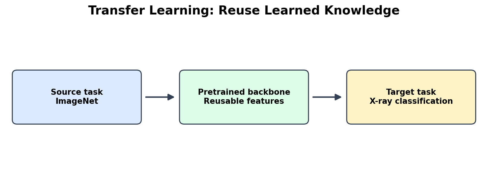
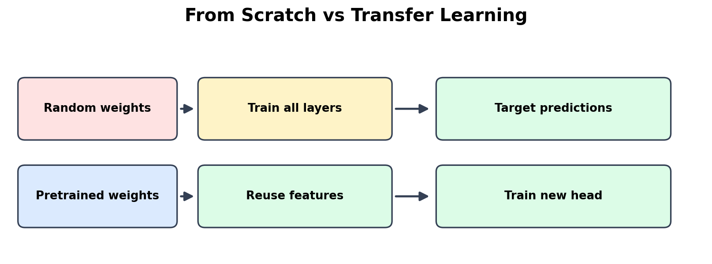
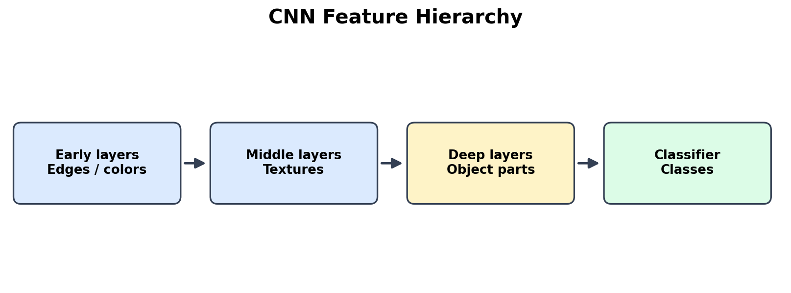
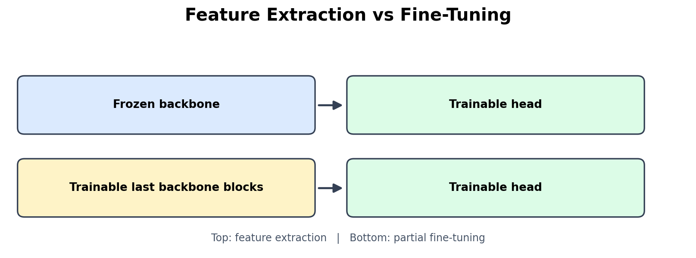
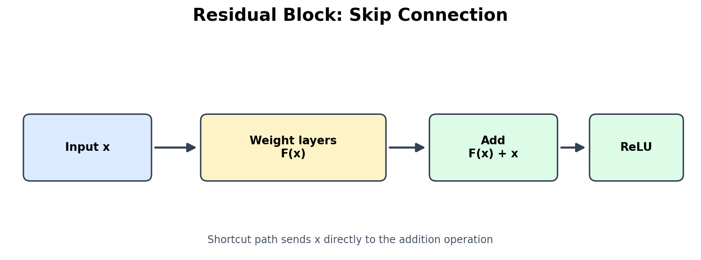
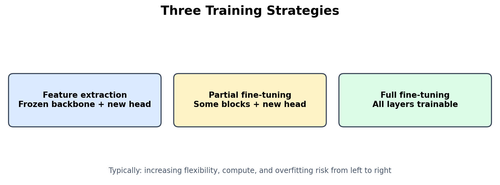
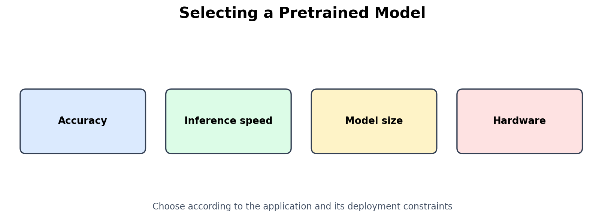

# Transfer Learning in Computer Vision

> A visual, beginner-friendly guide to pretrained CNNs, feature extraction, fine-tuning, residual connections, and model selection.
>
> Based on the provided **Transfer Learning** lecture (19 slides, prepared by Sandy Alaa). The figures below are original explanatory diagrams created for this README.

## Table of Contents
1. [What Is Transfer Learning?](#1-what-is-transfer-learning)
2. [Why Use Transfer Learning?](#2-why-use-transfer-learning)
3. [Training from Scratch vs Transfer Learning](#3-training-from-scratch-vs-transfer-learning)
4. [Pretrained Models and CNN Features](#4-pretrained-models-and-cnn-features)
5. [Feature Extraction vs Fine-Tuning](#5-feature-extraction-vs-fine-tuning)
6. [Famous CNN Architectures](#6-famous-cnn-architectures)
7. [Vanishing Gradients and ResNet](#7-vanishing-gradients-and-resnet)
8. [ResNet18 vs ResNet50](#8-resnet18-vs-resnet50)
9. [Freezing Layers and Fine-Tuning Strategies](#9-freezing-layers-and-fine-tuning-strategies)
10. [Choosing a Strategy](#10-choosing-a-strategy)
11. [Choosing a Model](#11-choosing-a-model)
12. [Key Takeaways](#12-key-takeaways)

---

## 1. What Is Transfer Learning?

**Transfer learning** reuses a model trained on a **source task** as a starting point for a related **target task**. Instead of learning visual patterns from random initialization, we reuse useful learned weights.

Think of someone who already knows how to ride a bicycle: learning to ride a motorcycle is easier because balance and steering skills transfer.



**Computer vision example:**
- **Source task:** classify approximately 1,000 ImageNet classes using roughly 1.2 million training images.
- **Reusable knowledge:** edges, textures, shapes, and more complex visual features.
- **Target task:** adapt the pretrained network to classify medical X-ray images.

**Important:** Transfer learning is a starting advantage, not a guarantee of accuracy. How well it works depends on the target data and its similarity to the source domain.

## 2. Why Use Transfer Learning?

Training a large CNN from scratch can require extensive labeled data, computing resources, and time. Transfer learning can offer:

| Benefit | Explanation |
| --- | --- |
| Less labeled data | Useful visual representations are already learned. |
| Faster training | Fewer parameters may need updating. |
| Lower compute cost | A small GPU or hosted notebook may be sufficient. |
| Stronger starting point | Pretrained weights can outperform random initialization. |
| Reduced overfitting risk | Freezing reusable features can help when data is scarce. |
| Knowledge reuse | Leverage features learned from a large source dataset. |

These are common advantages, not universal guarantees; performance depends on the architecture, dataset, and training strategy.

## 3. Training from Scratch vs Transfer Learning



**Training from scratch:** initialize all trainable weights randomly and learn visual features and the classifier from your own dataset.

**Transfer learning:** initialize from pretrained weights and retrain only the parts needed for your new task.

| Aspect | Training from scratch | Transfer learning |
| --- | --- | --- |
| Initial weights | Random | Pretrained |
| Typical data requirement | Larger | Often small to medium |
| Typical training time | Longer | Shorter |
| Compute requirement | Often higher | Often lower |
| Small-dataset overfitting | More likely | Often reduced |
| Good fit | Very large or substantially different domains | Many practical vision projects |

## 4. Pretrained Models and CNN Features

A **pretrained model** has already learned weights from a previous dataset and makes those weights available for reuse. Many common computer-vision backbones were trained on **ImageNet**.



As a CNN becomes deeper, it tends to learn progressively more abstract patterns:

1. **Early layers:** lines, edges, simple colors.
2. **Middle layers:** textures and recurring patterns.
3. **Deeper layers:** object parts such as eyes and wheels.
4. **Classifier:** converts features into scores for the source classes.

The early layers often transfer well across tasks, while the final classifier usually needs replacement for the target classes.

### Backbone and head

- **Backbone:** extracts image features.
- **Classification head:** maps features to the target labels.

For example, if a pretrained model predicts 1,000 ImageNet classes but your dataset contains **cats and dogs**, replace its final classifier with a head that outputs **2 class scores**.

## 5. Feature Extraction vs Fine-Tuning



### Feature extraction

Freeze the pretrained backbone and train only the new classification head.

- Backbone weights stay unchanged.
- The new head learns the target classes.
- Usually faster and less memory-intensive.
- Often a good first approach with limited data.

### Fine-tuning

Continue training **some or all** pretrained backbone layers, normally with a small learning rate.

- Lets the visual features adapt to the target domain.
- Can improve results when the source and target images differ.
- Costs more time and compute and can overfit a small dataset.

| Feature extraction | Fine-tuning |
| --- | --- |
| Frozen backbone | Some/all backbone layers trainable |
| Train new head | Train head plus selected backbone layers |
| Lower compute | Higher compute |
| Strong baseline for small data | More flexible adaptation |

## 6. Famous CNN Architectures

The lecture highlights several influential architectures and their key ideas.

| Model | Year | Main contribution | Notes |
| --- | --- | --- | --- |
| **AlexNet** | 2012 | Popularized GPU-trained deep CNNs, ReLU, and dropout | 5 convolutional + 3 fully connected layers; ~60M parameters |
| **VGG** | 2014 | Simple repeated 3×3 convolutions | VGG16 ~138M parameters; relatively heavy |
| **Inception / GoogLeNet** | 2014 | Parallel filters of multiple sizes | Inception modules combine 1×1, 3×3, 5×5 operations and pooling |
| **ResNet** | 2015 | Residual / skip connections | Makes very deep networks easier to optimize |
| **DenseNet** | 2017 | Dense connections concatenate earlier feature maps | DenseNet-121 ~8M parameters |
| **MobileNet** | 2017 | Efficient depthwise separable convolutions | Designed for mobile and embedded devices |
| **EfficientNet** | 2019 | Compound scaling of depth, width, and resolution | B0–B7 trade model cost for capacity |

### AlexNet
AlexNet helped establish modern deep CNN training. It used larger early convolutional filters, ReLU, dropout, data augmentation, and GPUs. Its 2012 ImageNet result was a major milestone.

### VGG
VGG stacks small **3×3 convolutions** and pooling operations. Stacking two 3×3 layers gives a receptive field comparable to one 5×5 layer while adding nonlinearity. VGG16 and VGG19 are well-known variants, but their large parameter counts make them expensive.

### Inception
Inception processes inputs with **multiple filter sizes in parallel**, then combines their outputs. **1×1 convolutions** can reduce channel dimensions and computation. GoogLeNet introduced a 22-layer architecture; later variants include Inception v3 and v4.

### DenseNet
DenseNet connects each layer to preceding feature maps within a dense block, typically by **concatenation**. This encourages feature reuse and gradient flow, though retaining many feature maps can increase memory usage.

### MobileNet
MobileNet targets constrained hardware. **Depthwise separable convolution** applies spatial filtering per channel, then uses a **1×1 pointwise convolution** to combine channels. This greatly reduces computation compared with a standard convolution. Later variants include MobileNetV2 and V3.

### EfficientNet
EfficientNet jointly scales **network depth**, **channel width**, and **input resolution**, instead of scaling only one. Larger B-family variants typically require more compute and memory.

## 7. Vanishing Gradients and ResNet

### The vanishing-gradient problem

During backpropagation, gradients pass through many layers. If their magnitudes repeatedly shrink, early layers receive extremely small updates and may learn slowly.

### The degradation problem

Making a plain network deeper does **not** always make it easier to train. The lecture notes that a 56-layer plain network showed higher *training error* than a 20-layer counterpart, indicating an optimization problem rather than simply overfitting.

### Residual learning

**ResNet**, introduced in 2015, uses a shortcut to add the input to the output of a learned transformation:

\[
\mathbf{y} = F(\mathbf{x}) + \mathbf{x}
\]

Here, **x** is the input and **F(x)** is the residual transformation learned by the block. This creates a more direct path for gradients through the network.



**Conceptual flow:** `x → convolutional layers → F(x)` and, in parallel, `x → shortcut`; both are **added**, then an activation may be applied.

### Two shortcut types

- **Identity shortcut:** add the unchanged input when tensor shapes match.
- **Projection shortcut:** use a **1×1 convolution** to align channel counts and/or spatial dimensions when necessary.

ResNet models with 50, 101, and 152 layers use residual connections to make deep-network optimization more practical.

## 8. ResNet18 vs ResNet50

| Feature | ResNet18 | ResNet50 |
| --- | --- | --- |
| Residual block | Basic block: two 3×3 convolutions | Bottleneck: 1×1 → 3×3 → 1×1 |
| Blocks per stage | 2–2–2–2 | 3–4–6–3 |
| Parameters | ~11.7M | ~25.6M |
| ImageNet top-1 (lecture figures) | ~69.8% | ~76.1% |
| Approximate weight size | ~45 MB | ~98 MB |
| Relative speed | Faster | Slower |
| Typical use | Quick experiments, constrained compute | Stronger backbone when resources permit |

**Why bottleneck blocks?** A first 1×1 convolution reduces channels, the 3×3 convolution processes them, and a final 1×1 convolution expands channels again. This helps build deeper networks more efficiently.

> Accuracy and file-size figures are approximate lecture values; exact results depend on model weights and evaluation settings.

## 9. Freezing Layers and Fine-Tuning Strategies

**Freezing** means preventing a layer's weights from being updated during training. The layer still performs its forward computation.



### Strategy A — Feature extraction

Freeze **all backbone layers** and train the new head. Often best as a quick baseline for a small dataset.

### Strategy B — Partial fine-tuning

Freeze early layers, unfreeze some later backbone blocks, and train those blocks together with the new head. Often useful with medium-sized data or a moderately different domain.

### Strategy C — Full fine-tuning

Unfreeze the entire network and continue training from pretrained weights. Offers the most flexibility, but usually needs more compute, careful learning rates, and overfitting control.

| Strategy | Frozen layers | Trainable layers | Typical cost |
| --- | --- | --- | --- |
| Feature extraction | Entire backbone | New head | Lowest |
| Partial fine-tuning | Early backbone blocks | Later blocks + head | Medium |
| Full fine-tuning | None | All layers | Highest |

## 10. Choosing a Strategy

The lecture organizes the choice around **dataset size** and **similarity to ImageNet**:

| Target dataset | Similar to ImageNet | Different domain |
| --- | --- | --- |
| **Small** | Feature extraction (e.g., cats vs dogs) | Partial fine-tuning with augmentation (e.g., X-rays) |
| **Large** | Partial or full fine-tuning | Full fine-tuning; consider scratch training if data is huge and substantially different |

### Practical tips

1. **Train the new head first**, before unfreezing the backbone.
2. **Unfreeze gradually**, starting with later layers.
3. **Use a smaller learning rate** for pretrained layers (the lecture suggests often around 10× smaller).
4. **Match the original model's input preprocessing**, such as required image size and ImageNet normalization, where applicable.
5. **Validate on held-out data** to compare strategies and watch for overfitting.

## 11. Choosing a Model

There is no universally best pretrained model. The lecture recommends balancing four factors:



- **Accuracy:** how reliably the model predicts the desired classes.
- **Speed:** inference latency or frames per second.
- **Model size:** parameters and storage requirements.
- **Hardware:** available GPU memory, RAM, CPU, or mobile/edge resources.

**Examples:** MobileNet is attractive for constrained devices; ResNet18 is useful for quick baselines; ResNet50 offers a larger backbone; EfficientNet variants offer different accuracy/compute trade-offs. Benchmark candidates on your **actual target dataset and hardware**.

## 12. Key Takeaways

- Transfer learning starts from **pretrained weights** rather than random weights.
- A CNN's **backbone** extracts features; its **head** predicts classes.
- **Feature extraction** trains only the new head; **fine-tuning** also updates backbone layers.
- **ResNet skip connections** help train deep networks by creating direct signal paths.
- The right strategy depends on **dataset size**, **domain similarity**, and **available compute**.
- Start with a simple pretrained baseline, evaluate it, and fine-tune only if needed.

---

### Attribution

**Lecture source:** *Transfer Learning* (19-slide PDF), prepared by **Sandy Alaa**. This README paraphrases and organizes the lecture content for study purposes. All images in `images/` were newly drawn for this repository and are not extracted from the slides.

### Repository structure

```text
Transfer-Learning/
├── README.md
└── images/
    ├── 01_transfer_learning.png
    ├── 02_scratch_vs_transfer.png
    ├── 03_feature_hierarchy.png
    ├── 04_freezing_strategies.png
    ├── 05_residual_block.png
    ├── 06_three_strategies.png
    └── 07_model_selection.png
```

> Keep the `images` folder **next to** this README. GitHub resolves `images/filename.png` relative to the README's location, not necessarily the repository root.
