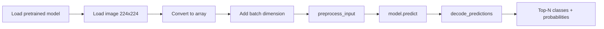
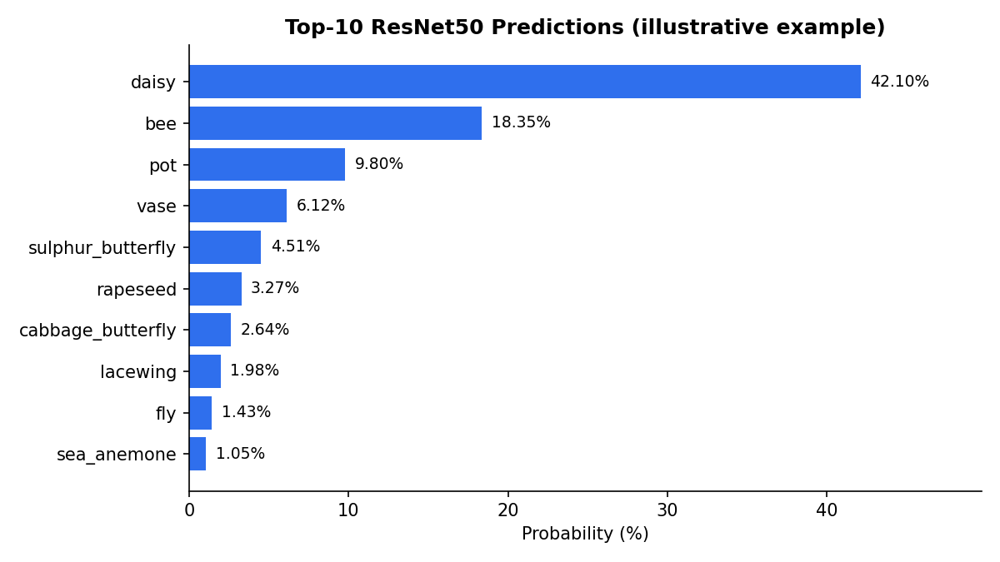

# Image Classification with Pretrained Keras Applications (ResNet50)

A short, practical guide to classifying images with a **pretrained ImageNet model** from [Keras Applications](https://keras.io/api/applications/), using **ResNet50** as the example. No training is required: you load the model, prepare an image, and read the predictions.


---

## Table of Contents

1. [Overview](#overview)
2. [Pipeline](#pipeline)
3. [Requirements](#requirements)
4. [Quick Start](#quick-start)
5. [Step-by-Step Explanation](#step-by-step-explanation)
6. [Example Output](#example-output)
7. [Reusable Function](#reusable-function)
8. [Using Other Models](#using-other-models)
9. [Common Pitfalls](#common-pitfalls)
10. [References](#references)

---

## Overview

Keras Applications provides deep learning models with pretrained weights that can be used for **prediction**, **feature extraction**, and **fine-tuning**. This guide covers the prediction use case: take any image and get the top-N ImageNet classes (1,000 classes in total) with their probabilities.

<p align="center">
  
  <br/>
  <em>Sample input image (<code>assets/sample.jpg</code>)</em>
</p>

> Place your own image in the `assets/` folder (or change the path in the code) so the picture above renders.

---

## Pipeline



---

## Requirements

- Python 3.9+
- TensorFlow / Keras
- NumPy
- Pillow (used internally by `load_img`)

```bash
pip install tensorflow numpy pillow
```

---

## Quick Start

```python
from keras.applications.resnet50 import ResNet50, preprocess_input, decode_predictions
from keras.utils import load_img, img_to_array
import numpy as np

# 1. Load the model with ImageNet weights
model = ResNet50(weights="imagenet")

# 2. Load and resize the image
img = load_img("/content/1.jpg", target_size=(224, 224))
img = img_to_array(img)

# 3. Add the batch dimension -> (1, 224, 224, 3)
img = np.expand_dims(img, axis=0)

# 4. Apply the model-specific preprocessing
img = preprocess_input(img)

# 5. Predict
predict = model.predict(img)

# 6. Decode the top-10 predictions
result = decode_predictions(predict, top=10)[0]

for class_id, class_name, class_prob in result:
    print(f"{class_name}: {class_prob * 100:.2f}%")
```

---

## Step-by-Step Explanation

### 1. Imports

```python
from keras.applications.resnet50 import ResNet50, preprocess_input, decode_predictions
from keras.utils import load_img, img_to_array
import numpy as np
```

| Import | Purpose |
|---|---|
| `ResNet50` | The model architecture (50-layer residual network). |
| `preprocess_input` | Applies the exact preprocessing the model was trained with. |
| `decode_predictions` | Converts the 1000-value output vector into readable class labels. |
| `load_img`, `img_to_array` | Read an image from disk and convert it to a NumPy array. |

### 2. Load the pretrained model

```python
model = ResNet50(weights="imagenet")
```

On first run, Keras downloads the weights (roughly 100 MB) and caches them under `~/.keras/models/`. Later runs load from the cache.

### 3. Load and resize the image

```python
img = load_img("/content/1.jpg", target_size=(224, 224))
img = img_to_array(img)
```

ResNet50 expects **224 × 224** RGB input. `load_img` resizes the image, and `img_to_array` converts it to a `float32` array of shape `(224, 224, 3)`.

### 4. Add a batch dimension

```python
img = np.expand_dims(img, axis=0)   # (224, 224, 3) -> (1, 224, 224, 3)
```

Keras models always expect a **batch** of images. A single image is a batch of size 1.

### 5. Preprocess

```python
img = preprocess_input(img)
```

This step is **model-specific**. For ResNet50 it converts RGB to BGR and subtracts the ImageNet channel means. Skipping it, or using another model's `preprocess_input`, noticeably degrades accuracy.

### 6. Predict

```python
predict = model.predict(img)        # shape: (1, 1000)
```

The output is a vector of 1000 probabilities, one per ImageNet class.

### 7. Decode the predictions

```python
result = decode_predictions(predict, top=10)[0]

for class_id, class_name, class_prob in result:
    print(f"{class_name}: {class_prob * 100:.2f}%")
```

`decode_predictions` returns, for each image in the batch, a list of `(class_id, class_name, probability)` tuples sorted from most to least likely. `[0]` selects the first (and only) image.

---

## Example Output

The values below are **illustrative** for a photo of a golden retriever. Your results will depend on your image.

```text
golden_retriever: 87.42%
Labrador_retriever: 6.11%
cocker_spaniel: 1.35%
Irish_setter: 0.92%
kuvasz: 0.64%
Sussex_spaniel: 0.41%
clumber: 0.33%
English_setter: 0.28%
Chesapeake_Bay_retriever: 0.19%
Brittany_spaniel: 0.14%
```

For a visual result, you can plot the top predictions next to the image:

```python
import matplotlib.pyplot as plt

labels = [name for _, name, _ in result][::-1]
probs = [p * 100 for _, _, p in result][::-1]

plt.figure(figsize=(8, 4))
plt.barh(labels, probs)
plt.xlabel("Probability (%)")
plt.title("Top-10 ResNet50 Predictions")
plt.tight_layout()
plt.savefig("assets/predictions.png", dpi=150)
plt.show()
```



---

## Reusable Function

The same workflow, wrapped into a clean function:

```python
import numpy as np
from keras.applications.resnet50 import ResNet50, preprocess_input, decode_predictions
from keras.utils import load_img, img_to_array

model = ResNet50(weights="imagenet")


def classify_image(image_path: str, top: int = 5, target_size=(224, 224)):
    """Return the top-N ImageNet predictions for an image.

    Args:
        image_path: Path to the image file.
        top: Number of predictions to return.
        target_size: Input size expected by the model.

    Returns:
        List of (class_id, class_name, probability) tuples.
    """
    img = load_img(image_path, target_size=target_size)
    x = img_to_array(img)
    x = np.expand_dims(x, axis=0)
    x = preprocess_input(x)

    preds = model.predict(x, verbose=0)
    return decode_predictions(preds, top=top)[0]


if __name__ == "__main__":
    for _, name, prob in classify_image("assets/sample.jpg", top=5):
        print(f"{name}: {prob * 100:.2f}%")
```

---

## Using Other Models

The workflow is identical for every model in Keras Applications. Only the **import path**, **input size**, and **`preprocess_input`** change, and each model has its own `preprocess_input`, so import it from the same module as the model.

```python
from keras.applications.efficientnet import EfficientNetB0, preprocess_input, decode_predictions

model = EfficientNetB0(weights="imagenet")
# EfficientNetB0 expects 224x224 input
```

| Model | Module | Input size |
|---|---|---|
| VGG16 / VGG19 | `keras.applications.vgg16` / `vgg19` | 224 × 224 |
| ResNet50 | `keras.applications.resnet50` | 224 × 224 |
| MobileNetV2 | `keras.applications.mobilenet_v2` | 224 × 224 |
| DenseNet121 | `keras.applications.densenet` | 224 × 224 |
| EfficientNetB0 | `keras.applications.efficientnet` | 224 × 224 |
| InceptionV3 | `keras.applications.inception_v3` | 299 × 299 |
| Xception | `keras.applications.xception` | 299 × 299 |

See the [official model list](https://keras.io/api/applications/) for the full catalog and sizes.

---

## Common Pitfalls

- **Wrong input shape:** the model expects `(batch, height, width, 3)`. Forgetting `np.expand_dims` raises a shape error.
- **Wrong or missing preprocessing:** always use the `preprocess_input` that matches the model.
- **Wrong target size:** use the model's native resolution (for example 299 × 299 for InceptionV3).
- **Grayscale or RGBA images:** `load_img` converts to RGB by default, so this is usually handled for you.
- **File not found in Colab:** upload the image first (or mount Google Drive) and verify the path.
- **Out-of-domain images:** ImageNet covers 1000 classes. Images outside that vocabulary (for example medical scans) need fine-tuning on your own data.

---

## References

- [Keras Applications documentation](https://keras.io/api/applications/)
- [ResNet paper: *Deep Residual Learning for Image Recognition* (He et al., 2015)](https://arxiv.org/abs/1512.03385)
- [ImageNet](https://www.image-net.org/)

---

## Suggested Project Structure

```text
.
├── README.md
├── assets/
│   ├── sample.jpg
│   └── predictions.png
├── classify.py
└── requirements.txt
```
