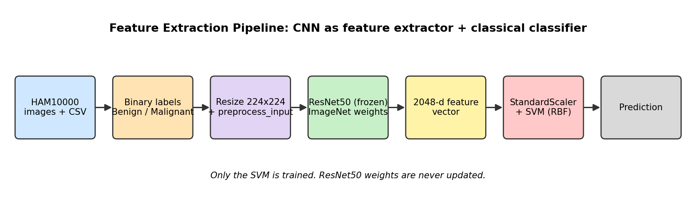
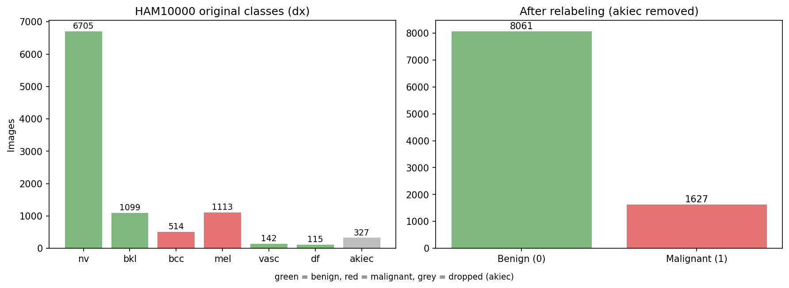
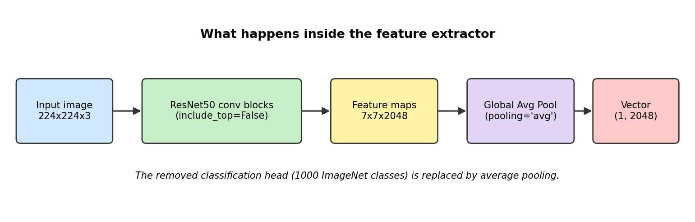
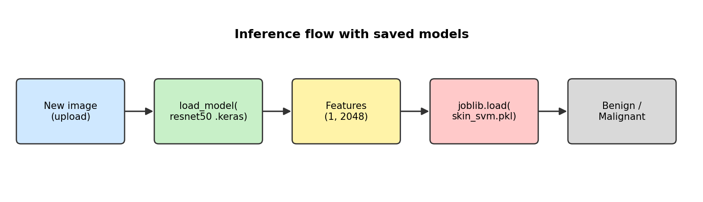

# Skin Lesion Classification with Feature Extraction (ResNet50 + SVM)

This lecture shows **Transfer Learning by Feature Extraction**: instead of training a deep network from scratch, we use a **pretrained ResNet50** (trained on ImageNet) as a *fixed* feature extractor, then train a small classical model (**SVM**) on top of those features.

The task: classify skin lesion images from the **HAM10000** dataset as **Benign** or **Malignant**.

> ⚠️ **Educational use only.** This is a learning project, not a medical diagnostic tool.

---

## Table of Contents
1. [The Big Idea](#1-the-big-idea)
2. [Pipeline Overview](#2-pipeline-overview)
3. [Setup: Kaggle and Dataset](#3-setup-kaggle-and-dataset)
4. [Exploring and Relabeling the Data](#4-exploring-and-relabeling-the-data)
5. [The Feature Extractor (ResNet50)](#5-the-feature-extractor-resnet50)
6. [Extracting Features for the Whole Dataset](#6-extracting-features-for-the-whole-dataset)
7. [Training the SVM Classifier](#7-training-the-svm-classifier)
8. [Saving the Models](#8-saving-the-models)
9. [Inference on a New Image](#9-inference-on-a-new-image)
10. [Known Issues and Improvements](#10-known-issues-and-improvements)
11. [Requirements](#11-requirements)

---

## 1. The Big Idea

| Approach | What is trained | Data needed | Speed |
|---|---|---|---|
| Train CNN from scratch | All weights | Very large | Slow |
| **Feature Extraction (this lecture)** | **Only the classifier (SVM)** | Small / medium | **Fast** |
| Fine-tuning | Some or all CNN layers + head | Medium | Medium |

A CNN pretrained on ImageNet already knows how to detect edges, textures, shapes and patterns. We reuse that knowledge by removing its classification head and treating its output as a **numeric description (feature vector)** of each image.

---

## 2. Pipeline Overview



1. Load the HAM10000 images and metadata.
2. Convert the 7 diagnosis classes into 2 labels (Benign / Malignant).
3. Pass every image through ResNet50 (frozen) to get a **2048-dimensional vector**.
4. Train an **SVM** on these vectors.
5. Save both models and use them to predict on new images.

---

## 3. Setup: Kaggle and Dataset

```python
!pip install -q kaggle
```
Installs the Kaggle CLI so we can download the dataset directly into Colab.

```python
from google.colab import files
files.upload()
```
Upload your `kaggle.json` API token (get it from Kaggle → Account → Create New API Token).

```python
!mkdir -p ~/.kaggle
!cp kaggle.json ~/.kaggle/kaggle.json
!chmod 600 ~/.kaggle/kaggle.json
```
Places the token where the Kaggle CLI expects it. `chmod 600` makes it readable only by you (required by Kaggle).

```python
!kaggle datasets download -d kmader/skin-cancer-mnist-ham10000
!unzip -q skin-cancer-mnist-ham10000.zip -d /content/skin_data
```
Downloads and extracts the dataset. You get:
- `HAM10000_metadata.csv` (labels and patient info)
- `ham10000_images_part_1/` and `ham10000_images_part_2/` (the images)

> 🔒 Never share or commit your `kaggle.json`.

---

## 4. Exploring and Relabeling the Data

```python
import pandas as pd

df = pd.read_csv("/content/skin_data/HAM10000_metadata.csv")
print(df.head())
print(df["dx"].value_counts())
```
`dx` is the diagnosis column. HAM10000 has 7 classes:

| Code | Meaning | Our label |
|---|---|---|
| `nv` | Melanocytic nevi (moles) | Benign (0) |
| `bkl` | Benign keratosis | Benign (0) |
| `vasc` | Vascular lesions | Benign (0) |
| `df` | Dermatofibroma | Benign (0) |
| `mel` | Melanoma | **Malignant (1)** |
| `bcc` | Basal cell carcinoma | **Malignant (1)** |
| `akiec` | Actinic keratoses (pre-cancerous) | *Dropped* |

```python
df = df[df["dx"] != "akiec"].copy()

df["label"] = df["dx"].apply(lambda x: 1 if x in ["mel", "bcc"] else 0)
print(df["label"].value_counts())
```
- `akiec` is removed because it is *pre-cancerous*, so it's ambiguous between benign and malignant.
- `mel` and `bcc` become `1` (Malignant); everything else becomes `0` (Benign).



Notice the **class imbalance**: far more benign than malignant images. We handle this later with `class_weight="balanced"`.

---

## 5. The Feature Extractor (ResNet50)

```python
from keras.applications.resnet50 import ResNet50, preprocess_input
from keras.utils import load_img, img_to_array
import numpy as np

base_model = ResNet50(
    weights="imagenet",
    include_top=False,
    pooling="avg"
)
```

| Argument | Meaning |
|---|---|
| `weights="imagenet"` | Load weights pretrained on ImageNet (1.2M images) |
| `include_top=False` | Remove the final 1000-class classification layer |
| `pooling="avg"` | Apply Global Average Pooling so output is a flat vector, not a 7×7×2048 map |



### Testing on a single image

```python
img = load_img(image_path, target_size=(224, 224))  # load + resize
img = img_to_array(img)                             # PIL image -> NumPy array
img = np.expand_dims(img, axis=0)                   # (224,224,3) -> (1,224,224,3)
img = preprocess_input(img)                         # ResNet-specific normalization
features = base_model.predict(img, verbose=0)
print(features.shape)                               # (1, 2048)
```

Step by step:
1. **`load_img(..., target_size=(224, 224))`**: ResNet50 expects 224×224 inputs.
2. **`img_to_array`**: converts to a NumPy array of shape `(224, 224, 3)`.
3. **`np.expand_dims(axis=0)`**: models expect a *batch*, so we add a batch dimension.
4. **`preprocess_input`**: applies the exact normalization ResNet50 was trained with (channel reordering and mean subtraction). **Skipping this hurts the features badly.**
5. **`predict`**: runs a forward pass only, with no training. Output shape `(1, 2048)`.

---

## 6. Extracting Features for the Whole Dataset

```python
from pathlib import Path

image_dirs = [
    Path("/content/skin_data/ham10000_images_part_1"),
    Path("/content/skin_data/ham10000_images_part_2")
]

image_paths = {
    img.stem: img
    for folder in image_dirs
    for img in folder.glob("*.jpg")
}
```
The images are split across two folders. This builds a dictionary `{image_id: file_path}` (e.g. `"ISIC_0032637" -> .../ISIC_0032637.jpg`) for instant lookup. `img.stem` is the filename without the `.jpg` extension.

```python
X_features = []
y_labels = []
batch_size = 32

for start in range(0, len(df), batch_size):
    batch_df = df.iloc[start:start + batch_size]
    batch_images = []

    for _, row in batch_df.iterrows():
        image_id = row["image_id"]
        image_path = image_paths.get(image_id)

        if image_path is None:
            raise FileNotFoundError(f"Image not found: {image_id}")

        img = load_img(image_path, target_size=(224, 224))
        img = img_to_array(img)
        batch_images.append(img)

    batch_images = np.array(batch_images)
    batch_images = preprocess_input(batch_images)

    batch_features = base_model.predict(batch_images, verbose=0)

    X_features.append(batch_features)
    y_labels.extend(batch_df["label"].values)

X_features = np.concatenate(X_features, axis=0)
y_labels = np.array(y_labels)
```

Why **batches**? Loading ~9,700 images at once would exhaust RAM. Processing 32 at a time keeps memory low and uses the GPU efficiently.

| Variable | Shape | Meaning |
|---|---|---|
| `X_features` | `(N, 2048)` | One feature vector per image |
| `y_labels` | `(N,)` | 0 = Benign, 1 = Malignant |

---

## 7. Training the SVM Classifier

```python
from sklearn.model_selection import train_test_split
from sklearn.pipeline import make_pipeline
from sklearn.preprocessing import StandardScaler
from sklearn.svm import SVC
from sklearn.metrics import classification_report

X_train, X_test, y_train, y_test = train_test_split(
    X_features, y_labels,
    test_size=0.2,
    random_state=42,
    stratify=y_labels
)

classifier = make_pipeline(
    StandardScaler(),
    SVC(class_weight="balanced")
)

classifier.fit(X_train, y_train)
y_pred = classifier.predict(X_test)

print(classification_report(y_test, y_pred, target_names=["Benign", "Malignant"]))
```

| Piece | Why it's used |
|---|---|
| `test_size=0.2` | 80% train, 20% test |
| `stratify=y_labels` | Keeps the Benign/Malignant ratio the same in both splits |
| `random_state=42` | Reproducible split |
| `StandardScaler()` | SVMs are sensitive to feature scale, so we normalize each feature to mean 0, std 1 |
| `SVC()` | Support Vector Machine (default RBF kernel) |
| `class_weight="balanced"` | Penalizes mistakes on the rare Malignant class more heavily |
| `make_pipeline` | Chains scaler and SVM, so the **same scaling** is automatically applied at prediction time |

### Reading the report
`classification_report` gives **precision, recall, F1** per class. For medical tasks, **recall on Malignant** matters most, because missing a cancer (false negative) is far worse than a false alarm. Don't rely on accuracy alone with imbalanced data.

---

## 8. Saving the Models

```python
import joblib
joblib.dump(classifier, "/content/skin_svm.pkl")

base_model.save("/content/resnet50_feature_extractor.keras")
```

We save **both** parts because inference needs both:
- `skin_svm.pkl`: the trained scaler and SVM (scikit-learn, saved with `joblib`)
- `resnet50_feature_extractor.keras`: the feature extractor (Keras format)

---

## 9. Inference on a New Image



```python
from google.colab import files
uploaded = files.upload()
```
Upload a skin lesion image.

```python
from keras.models import load_model

base_model = load_model("/content/resnet50_feature_extractor.keras")

img = load_img(image_file, target_size=(224, 224))
img = img_to_array(img)
img = np.expand_dims(img, axis=0)
img = preprocess_input(img)

features = base_model.predict(img, verbose=0)
```
The preprocessing **must be identical** to training: same size, same `preprocess_input`.

```python
classifier = joblib.load("/content/skin_svm.pkl")
prediction = classifier.predict(features)

if prediction[0] == 0:
    print("Predicted class: Benign")
else:
    print("Predicted class: Malignant")
```

---

## 10. Known Issues and Improvements

**Bug in the inference cell.** `files.upload()` returns a *dictionary* (`{filename: bytes}`), not a path, so `load_img(uploaded, ...)` fails. Fix:

```python
image_file = list(uploaded.keys())[0]
img = load_img(image_file, target_size=(224, 224))
```

**Possible data leakage.** HAM10000 has multiple images of the *same lesion* (`lesion_id` column). A random split can put the same lesion in both train and test, giving over-optimistic scores. Better: split by `lesion_id`.

```python
from sklearn.model_selection import GroupShuffleSplit
gss = GroupShuffleSplit(test_size=0.2, random_state=42)
train_idx, test_idx = next(gss.split(X_features, y_labels, groups=df["lesion_id"]))
```

**Other ideas to try**
- Add `probability=True` to `SVC` to get confidence scores, and tune the decision threshold to raise Malignant recall.
- Try other extractors (EfficientNet, DenseNet, ViT) and compare.
- Compare SVM with Logistic Regression or Random Forest on the same features.
- Cache `X_features` with `np.save` to avoid re-extracting every time.
- Move on to **fine-tuning** the last ResNet blocks for higher accuracy.
- Use `GridSearchCV` to tune `C` and `gamma`.

---

## 11. Requirements

```
tensorflow
keras
scikit-learn
pandas
numpy
joblib
kaggle
```

Runs on **Google Colab** (a free T4 GPU speeds up feature extraction a lot).

---

## Summary

> **Pretrained CNN → fixed feature vectors → simple classifier.**
> Fast to train, works with modest data, and is an excellent first step before fine-tuning.
