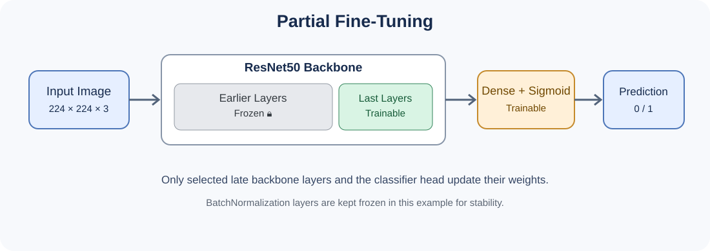
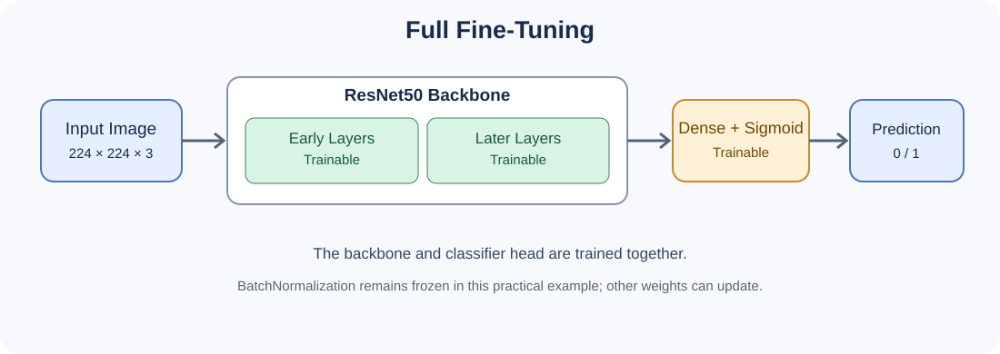

# ResNet50: Partial vs Full Fine-Tuning 🧠

A practical, beginner-friendly comparison of **Partial Fine-Tuning** and **Full Fine-Tuning** using a pretrained ResNet50 model and the HAM10000 skin-lesion image dataset.

> **Important medical note:** This is an educational binary-classification exercise, not a diagnostic tool. The labels below are a simplified mapping of dataset diagnoses, not a clinically validated benign/malignant assessment.

## 📌 Project Overview

In the original feature-extraction workflow, ResNet50 converts each image into a 2,048-dimensional feature vector, and an SVM learns to classify those vectors. In fine-tuning, we attach a small classification head to ResNet50 and train the neural network end-to-end to some degree.

### Feature Extraction vs Fine-Tuning

| Method | What gets trained? | Typical cost |
|---|---|---|
| Feature Extraction + SVM | The SVM only; ResNet50 stays frozen | Lowest |
| Partial Fine-Tuning | Classifier head + selected late ResNet50 layers | Medium |
| Full Fine-Tuning | Classifier head + nearly/all ResNet50 weights | Highest |

## 🖼️ Partial Fine-Tuning



Earlier layers remain frozen; selected late layers and the classifier head can update their weights.

## 🖼️ Full Fine-Tuning



The whole ResNet50 backbone is made trainable. This example keeps BatchNormalization layers frozen for stability, a common practical choice when fine-tuning pretrained models on relatively small datasets.

## 📂 Dataset

Dataset: [HAM10000 – Skin Cancer MNIST: HAM10000](https://www.kaggle.com/datasets/kmader/skin-cancer-mnist-ham10000)

The Kaggle dataset contains metadata in `HAM10000_metadata.csv` and images split across two folders in the common download.

This example preserves the simplified label mapping used in the feature-extraction notebook:
- `1` = `mel` or `bcc`
- `0` = other diagnoses retained after excluding `akiec`

This mapping should not be interpreted as a universal medical definition of benign versus malignant. Confirm the target definition before using this for research.

## ⚙️ Requirements

The code is intended for Google Colab with TensorFlow/Keras, pandas, scikit-learn, and the Kaggle API. A GPU runtime is recommended.

```python
!pip install -q kaggle scikit-learn pandas
```

Download and unzip the dataset using your Kaggle API token, as in the original notebook. The following code assumes the extracted files are under `/content/skin_data`.

## 1. Load and Prepare Metadata

```python
import pandas as pd

df = pd.read_csv("/content/skin_data/HAM10000_metadata.csv")

# Keep the same simplified target mapping as the feature-extraction notebook
df = df[df["dx"] != "akiec"].copy()
df["label"] = df["dx"].apply(
    lambda x: 1 if x in ["mel", "bcc"] else 0
)

print(df[["image_id", "dx", "label"]].head())
print(df["label"].value_counts())
```

## 2. Build Image Paths and Split the Data

**Important:** images belonging to the same `lesion_id` should not be scattered across train and test sets. Group-based splitting helps reduce leakage caused by multiple images of the same lesion.

```python
from pathlib import Path
from sklearn.model_selection import GroupShuffleSplit

image_dirs = [
    Path("/content/skin_data/ham10000_images_part_1"),
    Path("/content/skin_data/ham10000_images_part_2"),
]

image_paths = {
    p.stem: str(p)
    for folder in image_dirs
    for p in folder.glob("*.jpg")
}

df["image_path"] = df["image_id"].map(image_paths)
df = df.dropna(subset=["image_path"]).reset_index(drop=True)

splitter = GroupShuffleSplit(
    n_splits=1, test_size=0.20, random_state=42
)
train_idx, test_idx = next(
    splitter.split(df, y=df["label"], groups=df["lesion_id"])
)

train_df = df.iloc[train_idx].reset_index(drop=True)
test_df = df.iloc[test_idx].reset_index(drop=True)

print("Train images:", len(train_df))
print("Test images:", len(test_df))
```

For rigorous model selection, create a separate validation set as well. Keep the test set untouched until final evaluation.

## 3. Create TensorFlow Datasets

ResNet50 expects images resized to 224×224 and its own `preprocess_input` transformation.

```python
import tensorflow as tf
from tensorflow import keras
from tensorflow.keras import layers
from tensorflow.keras.applications.resnet50 import (
    ResNet50, preprocess_input
)

IMG_SIZE = (224, 224)
BATCH_SIZE = 32
AUTOTUNE = tf.data.AUTOTUNE

def load_image(path, label):
    image_bytes = tf.io.read_file(path)
    image = tf.image.decode_jpeg(image_bytes, channels=3)
    image = tf.image.resize(image, IMG_SIZE)
    image = preprocess_input(image)
    label = tf.cast(label, tf.float32)
    return image, label

def make_dataset(frame, training=False):
    ds = tf.data.Dataset.from_tensor_slices((
        frame["image_path"].values,
        frame["label"].values
    ))
    if training:
        ds = ds.shuffle(
            buffer_size=min(len(frame), 2000),
            seed=42,
            reshuffle_each_iteration=True
        )
    ds = ds.map(load_image, num_parallel_calls=AUTOTUNE)
    return ds.batch(BATCH_SIZE).prefetch(AUTOTUNE)

train_ds = make_dataset(train_df, training=True)
test_ds = make_dataset(test_df)
```

## 4. Build the Model

We use `include_top=False` to remove ImageNet's original classifier. `pooling="avg"` turns the final convolutional feature maps into a feature vector, then a new sigmoid output predicts the binary label.

```python
def build_model():
    backbone = ResNet50(
        weights="imagenet",
        include_top=False,
        pooling="avg",
        input_shape=(224, 224, 3)
    )
    backbone.trainable = False

    inputs = keras.Input(shape=(224, 224, 3))
    x = backbone(inputs, training=False)
    x = layers.Dropout(0.3)(x)
    outputs = layers.Dense(1, activation="sigmoid")(x)

    model = keras.Model(inputs, outputs)
    model.compile(
        optimizer=keras.optimizers.Adam(learning_rate=1e-3),
        loss="binary_crossentropy",
        metrics=["accuracy", keras.metrics.AUC(name="auc")]
    )
    return model, backbone

model, backbone = build_model()
model.summary()
```

### Step 1: Train the New Classification Head

First train with the backbone frozen. This gives the newly added Dense layer a reasonable starting point before fine-tuning pretrained weights.

```python
head_history = model.fit(
    train_ds,
    epochs=2,
    validation_data=test_ds
)
```

> For a clean final evaluation, use a validation dataset here instead of `test_ds`; the test set should be reserved for the end.

## 5. Partial Fine-Tuning

Unfreeze only the last 20 ResNet50 layers. BatchNormalization layers stay frozen to reduce instability on smaller datasets.

```python
backbone.trainable = True

# Freeze all backbone layers except the last 20
for layer in backbone.layers[:-20]:
    layer.trainable = False

# Keep BatchNormalization layers frozen
for layer in backbone.layers[-20:]:
    layer.trainable = not isinstance(
        layer, layers.BatchNormalization
    )

# Recompile after changing trainable layers
model.compile(
    optimizer=keras.optimizers.Adam(learning_rate=1e-5),
    loss="binary_crossentropy",
    metrics=["accuracy", keras.metrics.AUC(name="auc")]
)

partial_history = model.fit(
    train_ds,
    epochs=3,
    validation_data=test_ds
)
```

### What matters?

- `backbone.trainable = True`: allows layers to be individually marked trainable.
- `backbone.layers[:-20]`: selects every layer except the last 20.
- `layer.trainable = False`: freezes a layer's weights.
- A small learning rate such as `1e-5` helps avoid large changes to pretrained weights.
- `model.compile(...)` must be called again after changing trainability.

## 6. Full Fine-Tuning

To compare fairly, start from the same pretrained weights and the same head-only training stage. Do not continue from the partially fine-tuned weights if you want an independent comparison.

```python
# Build a fresh model and repeat the frozen-head training stage
full_model, full_backbone = build_model()

full_model.fit(
    train_ds,
    epochs=2,
    validation_data=test_ds
)

# Unfreeze the full backbone
full_backbone.trainable = True

# Keep BatchNormalization frozen for stability
for layer in full_backbone.layers:
    if isinstance(layer, layers.BatchNormalization):
        layer.trainable = False

full_model.compile(
    optimizer=keras.optimizers.Adam(learning_rate=1e-5),
    loss="binary_crossentropy",
    metrics=["accuracy", keras.metrics.AUC(name="auc")]
)

full_history = full_model.fit(
    train_ds,
    epochs=3,
    validation_data=test_ds
)
```

**Why rebuild `full_model`?** It avoids carrying the partially fine-tuned weights into the full fine-tuning experiment. Both experiments start from ImageNet weights and their own newly trained classifier head.

### Full Fine-Tuning, literally every layer

If you intentionally want BatchNormalization layers to be trainable too, remove the loop that freezes them. This is not always recommended for small datasets or small batch sizes.

## 7. Evaluate the Models

```python
print("Partial Fine-Tuning:")
partial_results = model.evaluate(test_ds, return_dict=True)
print(partial_results)

print("Full Fine-Tuning:")
full_results = full_model.evaluate(test_ds, return_dict=True)
print(full_results)
```

For a valid comparison, evaluate each model once on the same untouched test set, and compare more than accuracy: precision, recall, F1-score, ROC-AUC, and the confusion matrix can reveal class-imbalance problems.

## 8. Save the Models

```python
model.save("resnet50_partial_finetuned.keras")
full_model.save("resnet50_full_finetuned.keras")
```

## 🧠 Quick Summary

| Concept | Partial Fine-Tuning | Full Fine-Tuning |
|---|---|---|
| Backbone layers updated | Selected late layers | Nearly all layers (except frozen BatchNormalization in this example) |
| Trainable parameters | Fewer | More |
| Training speed | Usually faster | Usually slower |
| Memory use | Usually lower | Usually higher |
| Overfitting risk | Often lower | Can be higher |
| Best choice | Limited data/compute or modest adaptation | More data/compute and stronger domain adaptation needs |

## ⚠️ Notes

- Training time, accuracy, and best settings depend on the dataset split, hardware, preprocessing, and hyperparameters. No accuracy is guaranteed.
- Because HAM10000 has class imbalance and multiple images per lesion, use group-aware splitting and class-aware evaluation.
- A group-based split prevents a lesion from appearing in both train and test, but it does not automatically guarantee perfectly balanced classes.
- The binary label mapping here is kept for continuity with the source notebook and should be reviewed carefully for any research use.
- This project is for learning deep learning methods and must not be used to diagnose skin cancer.
