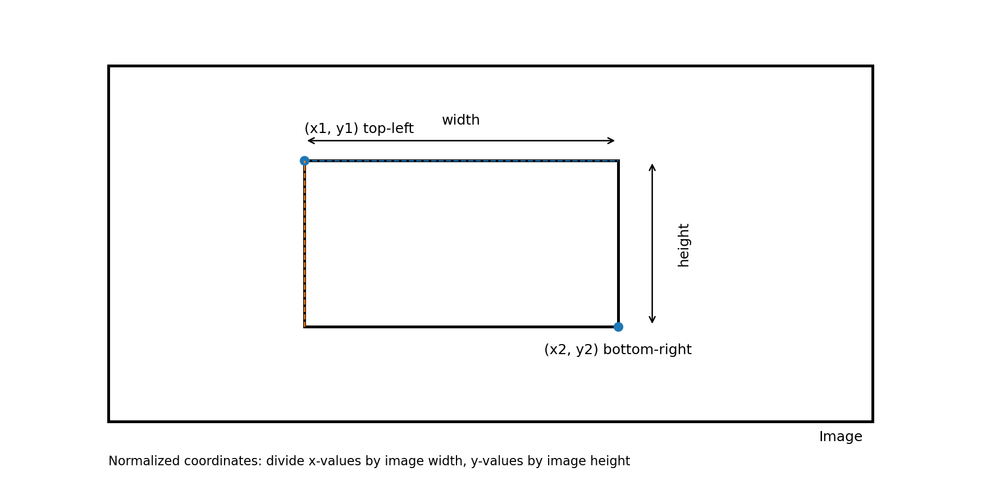
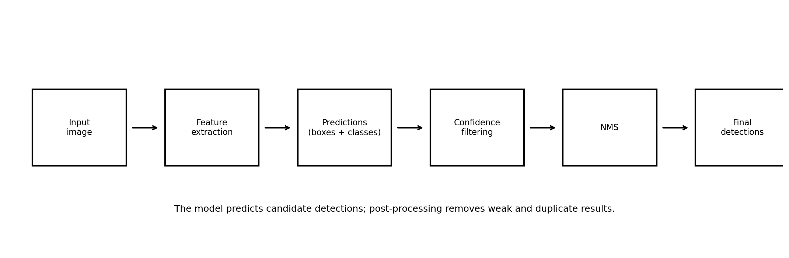
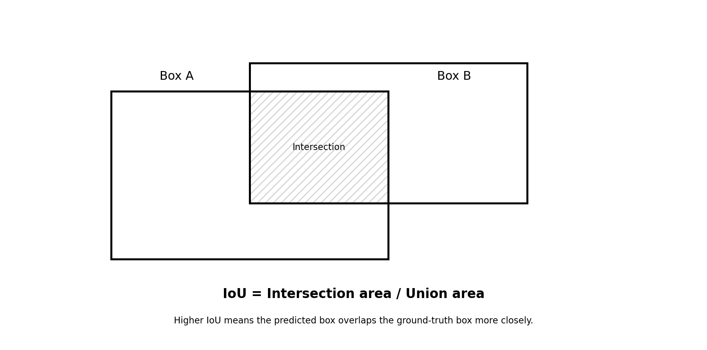
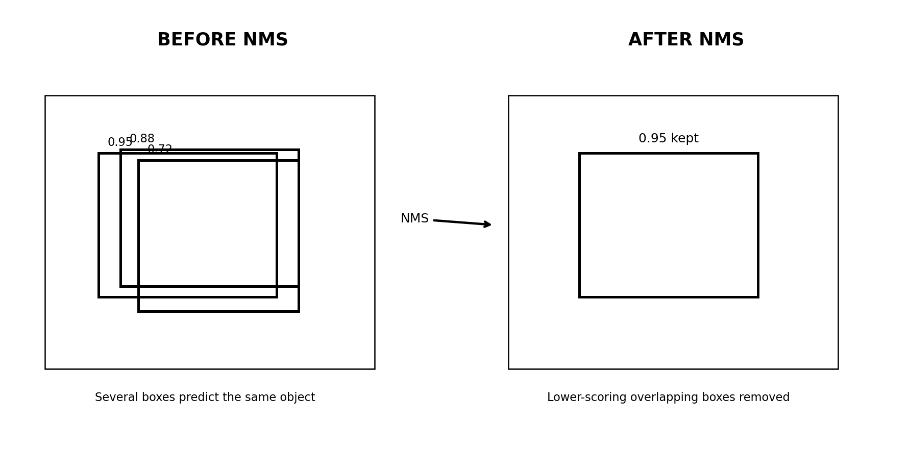
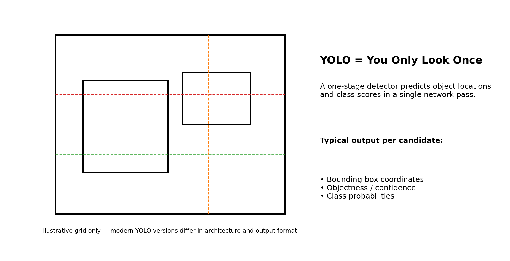

# Module 6 --- Object Detection

> **Goal:** Understand how a computer vision model finds multiple
> objects in one image, localizes each object with a bounding box,
> assigns a class, and estimates its confidence.

## Learning outcomes

By the end of this module, you should be able to: - Explain the
difference between image classification and object detection. -
Represent bounding boxes using corner or center-based coordinates. -
Understand the detection pipeline and the role of confidence scores. -
Calculate and interpret Intersection over Union (IoU). - Explain why
Non-Maximum Suppression (NMS) is needed. - Distinguish IoU, precision,
recall, AP, and mAP. - Compare two-stage and one-stage detectors. -
Explain the core idea behind YOLO and run a basic YOLO detection
project.

------------------------------------------------------------------------

## 6.1 Classification vs. Object Detection

**Image classification** answers: *What is in this image?* It usually
assigns one or more labels to the whole image. It does not tell us
exactly where each object is.

**Object detection** answers: *What objects are present, and where is
each one?* It returns a separate prediction for every detected
object: 1. Class label (for example, `person`, `car`, or `dog`). 2.
Bounding-box coordinates. 3. Confidence score.


  -----------------------------------------------------------------------
  Task                    Output                  Example
  ----------------------- ----------------------- -----------------------
  Classification          Image-level class       `dog`

  Object detection        Class + box +           `dog, box, 0.96` and
                          confidence for each     `person, box, 0.91`
                          object                  

  Object segmentation     Class + pixel-level     Exact pixels belonging
                          object mask             to the dog
  -----------------------------------------------------------------------

**Important:** Classification can be multi-label, but it still does not
provide object locations. Detection adds localization.

## 6.2 Bounding Boxes

A **bounding box** is a rectangle around an object. It identifies the
object's approximate location in the image.

### Common coordinate formats

**1. Corner format**

`(x1, y1, x2, y2)`

-   `(x1, y1)`: top-left corner.
-   `(x2, y2)`: bottom-right corner.
-   `width = x2 - x1`
-   `height = y2 - y1`

**2. Top-left + size format**

`(x, y, width, height)`

Here, `(x, y)` is commonly the top-left corner, but always check the
dataset or library convention.

**3. Center format**

`(x_center, y_center, width, height)`

This is commonly used in YOLO label files.



### Pixel coordinates vs. normalized coordinates

Pixel coordinates use the original image dimensions. If an image is 640
pixels wide and 480 pixels high, valid x-coordinates are generally
between 0 and 640, and y-coordinates between 0 and 480.

Normalized coordinates divide by image dimensions:

-   `x_normalized = x / image_width`
-   `y_normalized = y / image_height`
-   `width_normalized = width / image_width`
-   `height_normalized = height / image_height`

Normalized values are usually between 0 and 1. This makes labels
independent of the original image resolution.

**Example:** For a 640 × 480 image, a box center at `(320, 240)` becomes
`(0.5, 0.5)`.

### YOLO label format

A common YOLO text annotation line is:

``` text
class_id x_center y_center width height
```

All four box values are normalized. Each object in an image gets its own
line.

Example (illustrative):

``` text
0 0.50 0.50 0.25 0.40
2 0.72 0.35 0.15 0.20
```

The `class_id` is an integer mapped to a class name in the dataset
configuration. Do not assume class IDs are the same across datasets.

## 6.3 Object Detection Pipeline

A general object detection pipeline looks like this:



1.  **Input image:** The image is resized or otherwise preprocessed.
2.  **Feature extraction:** A neural network learns useful visual
    patterns such as edges, textures, shapes, and object parts.
3.  **Detection head:** The network predicts candidate boxes and
    class-related scores.
4.  **Confidence filtering:** Predictions below a chosen confidence
    threshold can be removed.
5.  **NMS:** Highly overlapping duplicate boxes are suppressed.
6.  **Final detections:** The remaining boxes are displayed with class
    names and scores.

The exact internal architecture differs between detector families. Some
models also use multiple feature-map scales to detect objects of
different sizes.

### What does a confidence score mean?

A confidence score expresses how strongly the model supports a candidate
detection. Its exact meaning depends on the model and implementation. In
some detectors, objectness and class probability are separate
quantities; in others, the final score is already combined.

A score of `0.92` is **not automatically a 92% guarantee** that the
prediction is correct. Scores are model estimates and may not be
perfectly calibrated.

## 6.4 IoU --- Intersection over Union

**IoU measures how much two bounding boxes overlap.** It is commonly
used to compare a predicted box with a ground-truth box.

\[ IoU =
`\frac{\text{Area of Intersection}}{\text{Area of Union}}`{=tex} \]

-   **Intersection:** Area shared by both boxes.
-   **Union:** Total area covered by either box, counting the shared
    area once.



### Worked example

Suppose: - Area of predicted box = 100 - Area of ground-truth box =
100 - Intersection area = 60

Then:

\[ Union = 100 + 100 - 60 = 140 \]

\[ IoU = `\frac{60}{140}`{=tex} `\approx 0.429`{=tex} \]

### Interpreting IoU

-   `0.00`: no overlap.
-   Near `0.50`: moderate overlap.
-   Near `1.00`: almost perfect overlap.

These are intuitive descriptions, not universal pass/fail rules.
Evaluation protocols define the IoU threshold. For example, a detection
may count as a true positive at IoU ≥ 0.50 if it also has the correct
class and matches an available ground-truth object.

**Do not confuse the two roles of IoU:** - In evaluation, IoU compares a
prediction with a ground-truth box. - In NMS, IoU compares candidate
predictions with one another.

## 6.5 Non-Maximum Suppression (NMS)

A detector may generate several boxes around the same object. This can
happen because multiple grid locations, anchors, or prediction
candidates respond to the same visual object.

If we display every candidate, one car might appear with five
overlapping rectangles. **Non-Maximum Suppression** reduces these
duplicates.



### Greedy NMS: the basic algorithm

For each class (in class-aware NMS):

1.  Remove candidates below the confidence threshold.
2.  Select the remaining box with the highest confidence score.
3.  Keep that box.
4.  Calculate its IoU with the other remaining boxes.
5.  Suppress boxes whose IoU is greater than the chosen NMS IoU
    threshold.
6.  Repeat until no candidates remain or a configured limit is reached.

### Confidence threshold vs. IoU threshold

  -----------------------------------------------------------------------
  Threshold               Controls                If increased
  ----------------------- ----------------------- -----------------------
  Confidence threshold    Minimum score required  Fewer, more confident
                          to keep a candidate     candidates remain

  NMS IoU threshold       How much overlap is     More overlap is
                          allowed before          tolerated; fewer boxes
                          suppressing a           are suppressed
                          lower-scoring box       
  -----------------------------------------------------------------------

**Example:** If the NMS IoU threshold is `0.5`, a lower-scoring box with
IoU `0.8` against a selected box is suppressed. A box with IoU `0.2` is
not suppressed by that comparison.

NMS variants include class-aware NMS, class-agnostic NMS, and Soft-NMS.
The exact behavior depends on the implementation.

## 6.6 Detection Metrics

Detection evaluation combines classification correctness and
localization quality.

### IoU

Measures overlap between a predicted box and a ground-truth box. An
evaluation protocol uses an IoU threshold to decide whether localization
is good enough.

### True Positive (TP), False Positive (FP), and False Negative (FN)

For a particular class and evaluation IoU threshold: - **TP:** A
correct-class prediction that matches a ground-truth object according to
the evaluation rules. - **FP:** A wrong-class, duplicate, or
insufficiently localized prediction (among other protocol-defined
cases). - **FN:** A ground-truth object that was not successfully
detected.

Matching rules matter: one ground-truth object generally cannot be
counted as matched by multiple predictions.

### Precision

\[ Precision = `\frac{TP}{TP + FP}`{=tex} \]

Precision answers: **Of all objects the model predicted, how many
predictions were correct?**

High precision means fewer false alarms.

### Recall

\[ Recall = `\frac{TP}{TP + FN}`{=tex} \]

Recall answers: **Of all real objects, how many did the model find?**

High recall means fewer missed objects.

### AP --- Average Precision

A detector's confidence threshold can be changed, producing different
precision and recall values. The **Precision--Recall (PR) curve** plots
precision against recall.

**Average Precision (AP)** summarizes the PR curve for one class under a
specified evaluation protocol. Implementations can differ in
interpolation and integration details, so report the benchmark
convention you use.

### mAP --- mean Average Precision

**mAP** is the mean of AP values across the evaluated classes.

\[ mAP = `\frac{1}{C}`{=tex}`\sum`{=tex}\_{c=1}\^{C} AP_c \]

where `C` is the number of classes included in the evaluation.

Common names: - **mAP@0.50:** AP computed using IoU threshold 0.50, then
averaged across classes. - **mAP@0.50:0.95:** Common COCO-style metric:
AP is evaluated at IoU thresholds from 0.50 to 0.95 in steps of 0.05,
then averaged across thresholds and classes.

**Important:** Always state the metric convention. A value called simply
`mAP` is ambiguous without its IoU thresholds and evaluation protocol.

## 6.7 Two-Stage Detectors

Two-stage detectors first propose likely object regions, then classify
and refine those regions.

### R-CNN (Regions with CNN features)

1.  Generate region proposals using an external proposal method.
2.  Run a CNN on each proposed region.
3.  Classify each region and refine its bounding box.

**Limitation:** Running the CNN separately for many proposals is
computationally expensive.

### Fast R-CNN

1.  Process the full image once with a CNN to create a feature map.
2.  Use region proposals.
3.  Extract a fixed-size feature representation for each proposal (using
    RoI Pooling).
4.  Classify each region and refine its box.

It avoids running the full CNN independently for every region, making it
much faster than R-CNN.

### Faster R-CNN

Adds a **Region Proposal Network (RPN)** that shares image features with
the detector and learns to generate region proposals.

Typical flow:

`Image → CNN feature map → RPN proposals → RoI features → classification + box refinement`

**Main idea:** The RPN replaces the external proposal-generation step
with a learned network.

### Summary

  Model          Main idea
  -------------- ------------------------------------------------------
  R-CNN          CNN features computed for many proposed regions
  Fast R-CNN     Shared CNN feature map + external proposals
  Faster R-CNN   Shared feature map + learned Region Proposal Network

Two-stage detectors are often strong when accurate region localization
is important, though speed and accuracy depend on the model, hardware,
and configuration.

## 6.8 One-Stage Detectors

One-stage detectors predict object locations and classes directly,
without a separate region-proposal stage.

### YOLO

**You Only Look Once** treats detection as a direct prediction problem.
A single network pass produces candidate boxes and class-related scores.
Modern YOLO families use different architectures and prediction heads,
but the central idea is efficient end-to-end detection.

### SSD --- Single Shot MultiBox Detector

SSD predicts boxes and class scores from multiple feature-map scales.
This helps it handle objects of different sizes.

### RetinaNet

RetinaNet introduced **Focal Loss**, which reduces the impact of the
many easy background examples during training. This addresses
foreground/background class imbalance in dense one-stage detection.

  Family      Main idea
  ----------- ----------------------------------------------
  YOLO        Direct object detection in one network pass
  SSD         Predictions from multiple feature-map scales
  RetinaNet   Dense detection with Focal Loss

### Two-stage vs. one-stage

  -----------------------------------------------------------------------
  Aspect                  Two-stage               One-stage
  ----------------------- ----------------------- -----------------------
  Main process            Propose regions, then   Predict boxes and
                          classify/refine         classes directly

  Examples                R-CNN, Fast R-CNN,      YOLO, SSD, RetinaNet
                          Faster R-CNN            

  Typical strength        Strong region-based     Efficient, often suited
                          localization            to real-time use

  Trade-off               Proposal and RoI        Dense predictions
                          processing add stages   require careful
                                                  handling of imbalance
                                                  and duplicates
  -----------------------------------------------------------------------

These are broad tendencies, not guarantees. Modern architectures vary
significantly.

## 6.9 YOLO --- You Only Look Once



### Core concept

YOLO is a family of one-stage object detectors. It processes an image
through a neural network and predicts candidate object detections
directly. The model can detect multiple objects and multiple classes in
the same image.

The grid shown above is a teaching illustration, **not** a claim that
every YOLO version uses the original YOLO grid formulation. Modern
versions may use multi-scale feature maps and different detection heads.

### What does YOLO predict?

A detection candidate generally contains: - **Bounding box:** Where the
object is. - **Class scores:** Which class the object may belong to. -
**Confidence/objectness information:** How strongly the candidate
represents an object.

The exact output representation differs between YOLO versions.

### YOLO inference workflow

1.  Load the trained model.
2.  Read an image or video frame.
3.  Preprocess the input (often resizing and normalization).
4.  Run the model to generate candidate detections.
5.  Apply confidence filtering.
6.  Apply NMS or the model's configured post-processing.
7.  Draw final bounding boxes, labels, and confidence scores.

### Example using Ultralytics YOLO

Install the package:

``` bash
pip install ultralytics opencv-python matplotlib
```

Run inference with a pretrained model:

``` python
from ultralytics import YOLO

# Load a pretrained YOLO model.
model = YOLO("yolo26n.pt")

# Run detection on an image.
results = model.predict(
    source="images/street.jpg",
    conf=0.25,
    iou=0.45,
    save=True
)

print("Detection complete. Check the runs/detect directory.")
```

> Model names and availability can change. Choose a model checkpoint
> supported by your installed Ultralytics version. A pretrained
> checkpoint detects the classes it was trained on; it does not
> automatically know custom classes.

### Read and inspect predictions

``` python
from ultralytics import YOLO

model = YOLO("yolo26n.pt")
results = model("images/street.jpg")

for result in results:
    for box in result.boxes:
        class_id = int(box.cls[0])
        confidence = float(box.conf[0])
        x1, y1, x2, y2 = box.xyxy[0].tolist()

        class_name = model.names[class_id]

        print(
            f"Class: {class_name} | "
            f"Confidence: {confidence:.2f} | "
            f"Box: ({x1:.1f}, {y1:.1f}, {x2:.1f}, {y2:.1f})"
        )
```

-   `box.cls`: predicted class ID.
-   `box.conf`: confidence score.
-   `box.xyxy`: box corners in pixel coordinates.
-   `model.names`: mapping from class IDs to class names.

### Display the annotated image

``` python
import matplotlib.pyplot as plt

result = results[0]
annotated_image = result.plot()  # BGR NumPy image

plt.figure(figsize=(12, 8))
plt.imshow(annotated_image[..., ::-1])  # Convert BGR to RGB for Matplotlib
plt.axis("off")
plt.show()
```

### Confidence and IoU settings in prediction

``` python
results = model.predict(
    source="images/street.jpg",
    conf=0.25,  # Minimum confidence score
    iou=0.45    # NMS IoU threshold (in standard Ultralytics prediction)
)
```

A higher `conf` removes more low-score candidates. A higher NMS `iou`
threshold generally allows more overlapping boxes to remain. These
settings affect post-processing, not the model's learned weights.

------------------------------------------------------------------------

# Project 5 --- YOLO Object Detection

## Project objective

Build an object detection application that uses YOLO to detect multiple
object classes and visualize each detection with: - A bounding box. -
The predicted class name. - The confidence score.

## Suggested project structure

``` text
project-5-yolo-object-detection/
│
├── images/
│   └── sample.jpg
│
├── outputs/
│
├── detect.py
├── requirements.txt
└── README.md
```

## Step 1 --- Install dependencies

Create `requirements.txt`:

``` text
ultralytics
opencv-python
matplotlib
```

Install:

``` bash
pip install -r requirements.txt
```

## Step 2 --- Create `detect.py`

``` python
from pathlib import Path
from ultralytics import YOLO
import cv2

# -----------------------------
# Configuration
# -----------------------------
MODEL_PATH = "yolo26n.pt"
IMAGE_PATH = "images/sample.jpg"
OUTPUT_DIR = Path("outputs")

CONFIDENCE_THRESHOLD = 0.25
NMS_IOU_THRESHOLD = 0.45

OUTPUT_DIR.mkdir(parents=True, exist_ok=True)

# -----------------------------
# Load model
# -----------------------------
model = YOLO(MODEL_PATH)

# -----------------------------
# Run object detection
# -----------------------------
results = model.predict(
    source=IMAGE_PATH,
    conf=CONFIDENCE_THRESHOLD,
    iou=NMS_IOU_THRESHOLD,
    verbose=False
)

# -----------------------------
# Process and save results
# -----------------------------
for image_index, result in enumerate(results):
    annotated = result.plot()

    output_path = OUTPUT_DIR / f"detection_{image_index}.jpg"
    cv2.imwrite(str(output_path), annotated)

    print(f"Saved visualization: {output_path}")

    if result.boxes is None:
        continue

    for box in result.boxes:
        class_id = int(box.cls[0])
        confidence = float(box.conf[0])
        x1, y1, x2, y2 = box.xyxy[0].tolist()

        class_name = model.names[class_id]

        print(
            f"{class_name:15s} "
            f"confidence={confidence:.3f} "
            f"box=({x1:.0f}, {y1:.0f}, {x2:.0f}, {y2:.0f})"
        )
```

Run:

``` bash
python detect.py
```

The annotated image will be saved in the `outputs/` directory.

## Step 3 --- Test multiple classes

Choose an image containing several objects, such as people, cars,
bicycles, or dogs. Confirm that: - More than one object can be
detected. - Different classes receive the correct labels. - Boxes are
placed around the objects. - Confidence scores are visible. - Duplicate
overlapping boxes are reduced by post-processing.

## Step 4 --- Experiment

Change one setting at a time and compare the output:

  -----------------------------------------------------------------------
  Experiment              Suggested values        What to observe
  ----------------------- ----------------------- -----------------------
  Confidence threshold    `0.10`, `0.25`, `0.50`  Number of detections
                                                  and false positives

  NMS IoU threshold       `0.30`, `0.45`, `0.70`  How many overlapping
                                                  boxes remain

  Model size              Nano / Small / Medium   Speed, resource usage,
                          (where supported)       and detection quality

  Input image             Small objects / crowded Which situations are
                          scene / clear scene     difficult
  -----------------------------------------------------------------------

## Project deliverables

1.  Python source code.
2.  `requirements.txt`.
3.  At least three test images.
4.  Saved output images showing bounding boxes, class labels, and
    confidence scores.
5.  A short report explaining the confidence and NMS IoU settings used.
6.  A short discussion of failure cases (missed objects, incorrect
    classes, or inaccurate boxes).

## Evaluation checklist

-   [ ] The model loads and runs successfully.
-   [ ] Multiple objects can be detected in one image.
-   [ ] Multiple classes are supported by the selected model.
-   [ ] Bounding boxes are drawn correctly.
-   [ ] Class labels are displayed.
-   [ ] Confidence scores are displayed.
-   [ ] Results are saved to the output directory.
-   [ ] Confidence and NMS thresholds are tested.
-   [ ] At least one failure case is discussed.

------------------------------------------------------------------------

## Quick Revision

  -----------------------------------------------------------------------
  Term                                Meaning
  ----------------------------------- -----------------------------------
  Classification                      Predict a class for an image

  Detection                           Predict object classes and
                                      locations

  Bounding box                        Rectangle locating an object

  Confidence                          Model score associated with a
                                      candidate detection

  IoU                                 Intersection area divided by union
                                      area

  NMS                                 Suppresses duplicate overlapping
                                      predictions

  Precision                           TP / (TP + FP)

  Recall                              TP / (TP + FN)

  AP                                  Area/summary of the
                                      Precision--Recall curve for one
                                      class

  mAP                                 Mean AP across classes (and,
                                      depending on the metric, IoU
                                      thresholds)

  R-CNN family                        Two-stage detection

  YOLO / SSD / RetinaNet              One-stage detection
  -----------------------------------------------------------------------

## Final takeaway

Object detection combines **classification** (what is the object?) with
**localization** (where is it?). A detector predicts boxes and
class-related scores; IoU helps measure box overlap, NMS removes
duplicate candidates, and AP/mAP summarize detection quality. YOLO makes
this practical through a one-stage detection approach that can be used
for images, videos, and real-time applications.
